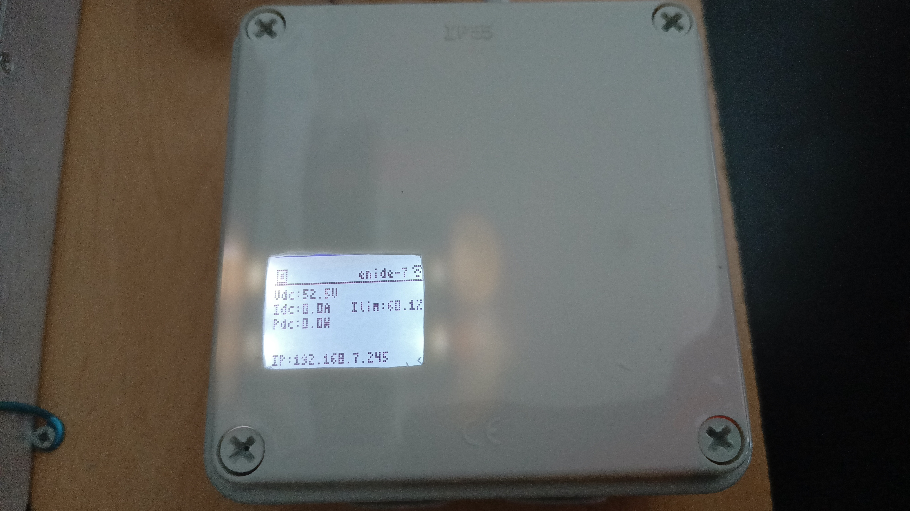
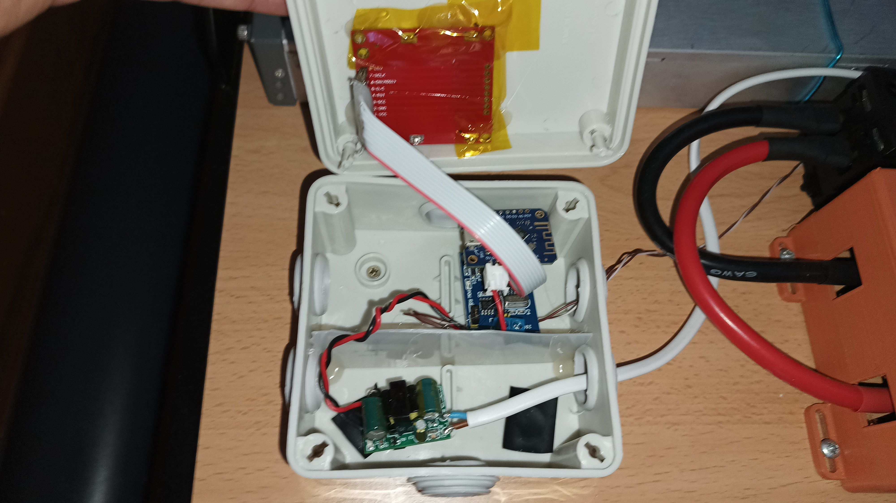
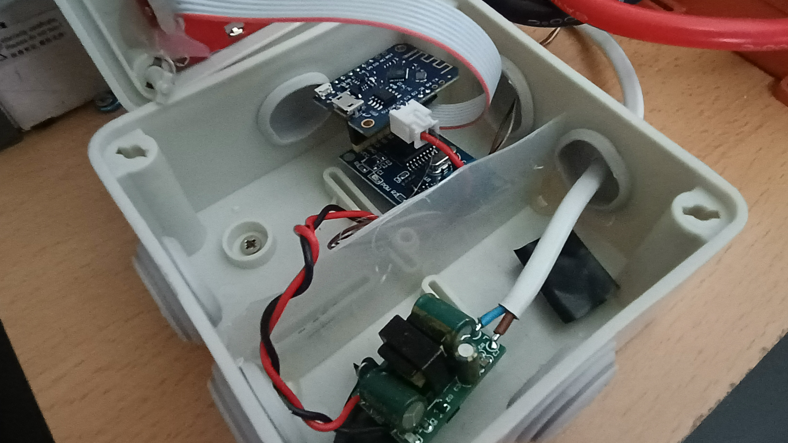
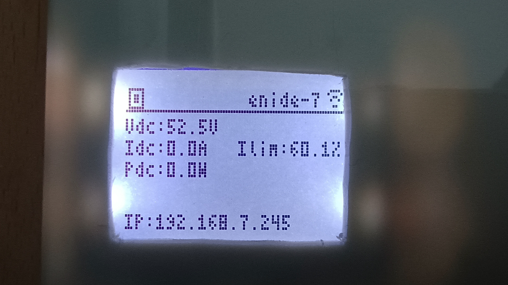

### My hardware setup
I purchased an electrical box and placed everything inside. The only thing visible on the outside is the LCD.

  

On the inside I have a 230V to 5V power supply (bottom), the Lolin D1 mini and the MCP2515 board (top right) and the LCD glued to the box lid.

A piece of plastic, glued to the box, creates a machanical barrier between the "high-voltage" side and the low voltage one.

  

Here's a close-up of the Lolin D1 mini and the MCP2515 board. They are stacked together.

  

And the live information fed to the display.

  

